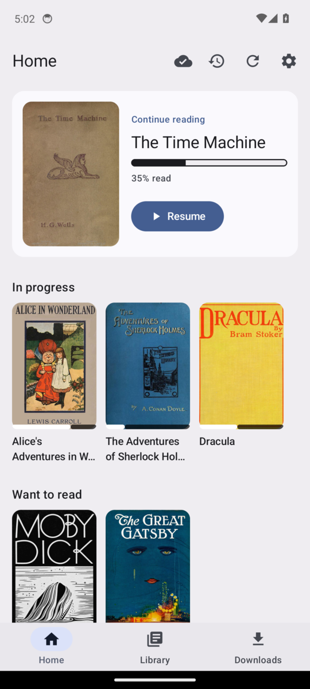
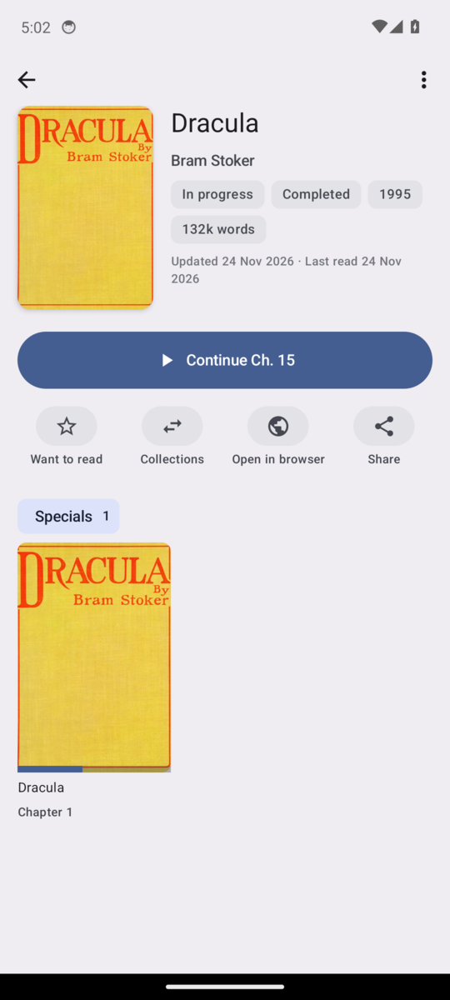
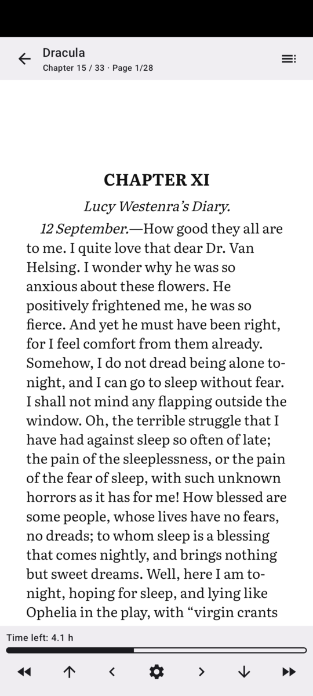
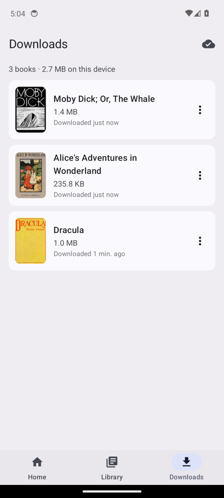
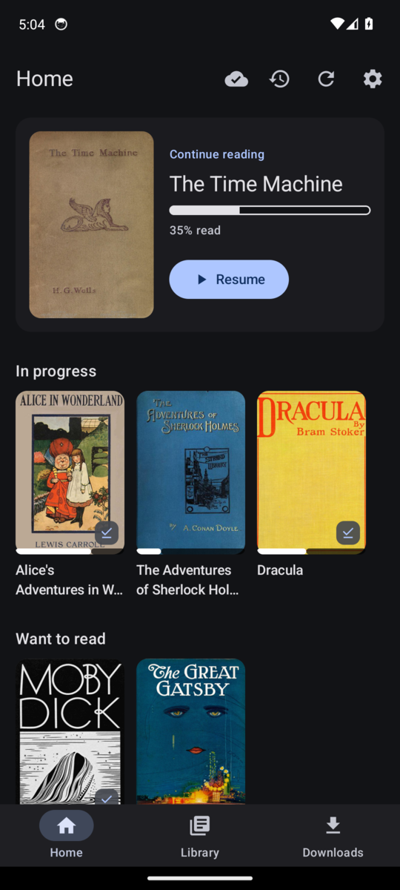
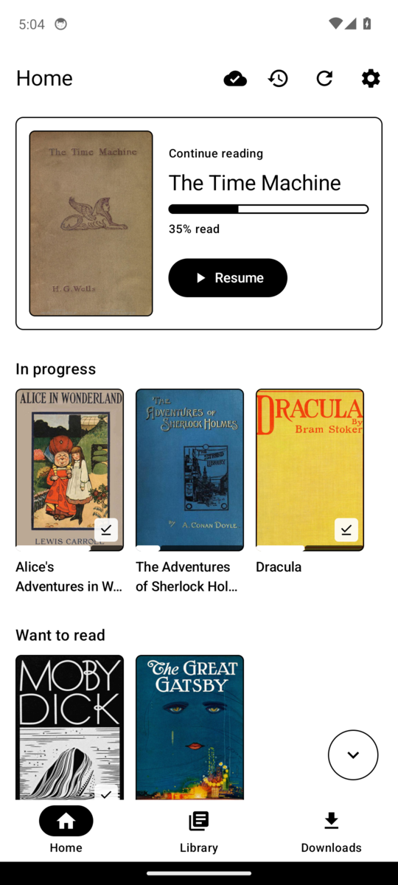
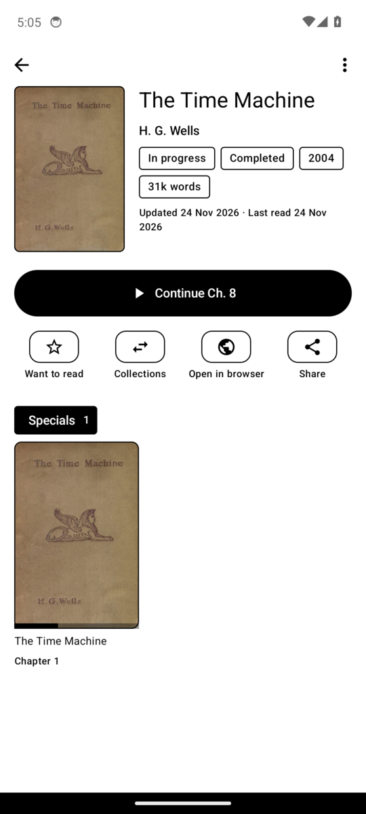

# Kavern

 Unofficial Android reader for your self-hosted **Kavita** library.

---

## Screenshots

<table>
  <tr>
    <td align="center"> Home</td>
    <td align="center"> Library</td>
    <td align="center"> Series page</td>
    <td align="center"> EPUB reader, paged</td>
  </tr>
  <tr>
    <td align="center"> Downloads</td>
    <td align="center"> Dark theme</td>
    <td align="center"> E-reader mode</td>
    <td align="center"> E-reader mode</td>
  </tr>
</table>

The screenshots use public-domain books from [Project Gutenberg](https://www.gutenberg.org/) on a test Kavita server.

---

## Overview

Kavern is a Kotlin/Jetpack Compose Android app to browse and read from your Kavita server. It aims for fast navigation, a clean reader, and tight API integration (collections, progress, metadata).

Kavern is a fork of [Inkita](https://github.com/dom-53/Inkita) by [dom-53](https://github.com/dom-53). This project would not exist without their work. Thank you!

**Tech:** Kotlin, Jetpack Compose (Material 3), Retrofit/OkHttp, WorkManager, Room/DataStore.
**Formats:** EPUB (primary), comics/images and PDF.
**Status:** Early release (v0.1); APIs and UI may change.

---

## Features

- **E-reader mode** (Settings → Appearance), switched on automatically on e-ink devices such as Boox readers: black and white with outlines instead of gray fills, no animations, a still loading mark, and page-by-page scrolling of long lists with on-screen buttons or the hardware page keys.
- Page-by-page EPUB reading like an e-reader (the default), or scrolling. Book styles, fonts and images are applied, while your own font, size, line height and alignment win over the book's.
- Hardware page buttons turn pages in the reader; optional volume keys, with a setting to reverse them.
- Word lookup (Define) for selected text, a table of contents, and "keep screen on".
- Home with a Continue reading card, series in progress, want to read and recently added, with reading progress on every cover.
- Library with live search, filters, collections, reading lists and people. Comics (CBZ, CBR, image folders) and PDF are listed too.
- Series pages with covers, metadata, tags, related items and specials.
- Downloads: one row per book with its cover and size, pause, cancel and retry, and per-chapter removal. Downloaded books open offline.
- Reading progress syncs to your server, also after reading offline.
- Network-aware: connectivity monitor, offline mode, and cached lists you can browse without a connection.
- Light, dark and system themes, with a softer light theme that is easier on the eyes.

---

## Install

Download the latest APK from the [Releases page](https://github.com/iquintero/Kavern/releases/latest) and open it on your device (Android 9 or newer). Android will ask you to allow installing from your browser or file manager the first time. Check the SHA-256 listed with each release if you want to verify the download.

Kavern has no built-in updater: to update, install the newer APK over the old one. Your login, downloads and settings are kept. It uses its own app ID, so it installs next to Inkita if you have that.

---

## Connecting to your Kavita server

Kavern ships without any preset server configuration. After the first launch:

1. Open **Settings → Kavita**.
2. Fill in your server URL credentials and your Kavita API key.
3. Save the configuration and restart app; the app will then authenticate and sync your libraries.

Without these details the app cannot reach your server, so make sure to keep them up to date (especially when rotating API keys).

---

## Building from source

1. **Prereqs:** Android Studio Giraffe+, JDK 17.
2. **Configure Kavita:** In-app settings → set server URL and API key.
3. **Run:** `./gradlew assembleDebug` or launch from Android Studio (preview/release buildTypes available).

> Requires your own Kavita server; no content is bundled.

---

## Contributing

Contributions are welcome (bugfixes, UX polish, docs). Please:
- Keep changes Compose-friendly and minimal.
- Align with Kavita API contracts.
- Add concise comments only where needed.
- Before opening an issue, check if it already exists.
- Before opening a PR, run `./gradlew detekt spotlessApply`.

## Logs / Debug
- You can export or save anonymized logs from **Settings → Advanced → Logs**; saved zips are written to `Documents/Kavern/logs`.
- Sensitive data (host/IP/API key) is anonymized in log files and exports.
- For bug reports: enable **Verbose logging**, reproduce the issue, then attach the exported ZIP to your issue/report.

---

## Disclaimer

Kavern is an unofficial community project, not affiliated with the Kavita team or the original Inkita project. Use at your own risk; APIs and behavior may change in 0.x releases.
